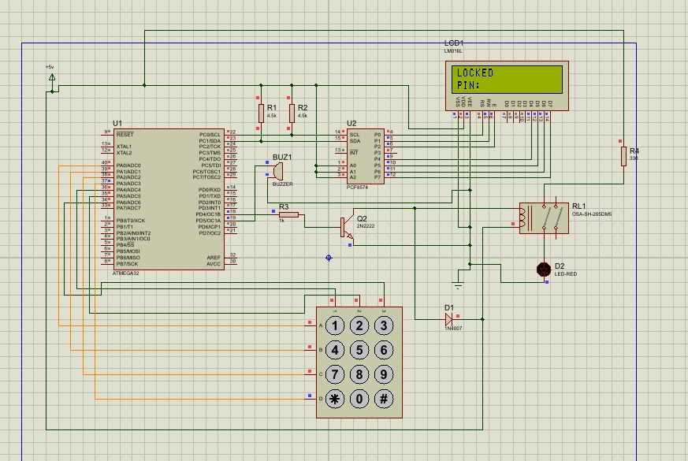

# Digital Door Lock — ATmega32 (Keypad PIN + Phone Voice Command over BLE)

A digital door lock built on an **ATmega32** that can be opened in **two independent ways**, with no priority between them:

1. **Keypad:** type a 4-digit PIN (stored in the internal EEPROM, default `1234`).
2. **Phone:** say a secret word to a web page; the page sends a secret text to the lock through an **HM-10 BLE** module.

Whichever method succeeds first opens the lock (relay ON for 5 seconds), and the result is shown on a 16×2 I2C LCD.

> **Important:** the phone side is a **voice command** (the page recognizes *what* is said), **not a voiceprint** (it does not verify *who* is speaking). See [Limitations](#limitations).



## Features

- Keypad PIN entry with `*` masking, `*` to clear, `D` to change the PIN (asks for the current PIN first)
- PIN stored in EEPROM (survives power loss)
- 3 wrong PINs → keypad locked for 30 s (the phone still works)
- Phone unlock over BLE (HM-10, 9600 baud), tolerant matching (case, spaces, `_` and `-` are ignored)
- Buzzer feedback, status LED on the relay contact, status messages sent back to the phone (`PHONE_OK`, `OK`, `WRONG`, `LOCKED`)
- LCD I2C address auto-detected (`0x27` or `0x3F`)

## Hardware

| Part | Notes |
|---|---|
| ATmega32 (DIP-40) | 16 MHz external crystal + 2 × 33 pF |
| 16×2 LCD with PCF8574 I2C backpack | address `0x27` / `0x3F` |
| 4×4 membrane keypad | |
| 5 V relay (SRD-05VDC-SL-C) | driven by NPN 2N2222 through 1 kΩ |
| 1N4007 | flyback diode across the relay coil |
| LED + 330 Ω | on the relay contact (represents the lock) |
| Buzzer | active, 5 V |
| HM-10 BLE module | UART 9600 baud |
| 1 kΩ + 2 kΩ | voltage divider for the HM-10 RXD pin (5 V → 3.3 V) |
| 10 kΩ + push button | reset |
| USBasp | programming (ISP) |
| 5 V / 2 A adapter | main power supply |

### Pin mapping

| Function | ATmega32 pin |
|---|---|
| Keypad rows R1–R4 | PA0–PA3 (pins 40–37) |
| Keypad columns C1–C4 | PA4–PA7 (pins 36–33), internal pull-ups |
| LCD SCL / SDA | PC0 (22) / PC1 (23) |
| Relay (via 2N2222) | PB0 (1) |
| Buzzer | PD5 (19) |
| HM-10 TXD → MCU RXD | PD0 (14) |
| HM-10 RXD ← MCU TXD | PD1 (15) through the 1 kΩ / 2 kΩ divider |
| Reset | pin 9 (10 kΩ pull-up + button) |
| Crystal | XTAL1 / XTAL2 (13 / 12) |
| VCC / AVCC | pins 10 / 30 |
| GND | pins 11 / 31 |

### Wiring notes

- Keep one **common GND** for everything.
- **HM-10 RXD must not receive 5 V** — use the divider.
- Power the circuit from the external 5 V supply. When programming, **remove the USBasp `VTRG` jumper** and do not connect its 5 V pin to the breadboard (keep GND connected).
- If the supply sags when the relay switches (LCD backlight dims), check the relay-driver wiring and add a 100 nF capacitor near the MCU and a 470 µF capacitor across the supply rails.

## Software

- Language: C (AVR-GCC), project created in **Microchip Studio** for **ATmega32**
- `F_CPU = 16000000`
- Main file: `main.c` (the firmware)

### Settings (top of `main.c`)

| Define | Meaning |
|---|---|
| `PHONE_TOKEN` | secret text the phone must send (uppercase, no spaces/underscores) |
| `DEFAULT_PIN` | PIN written to EEPROM on first run |
| `MAX_TRIES`, `LOCKOUT_S` | wrong attempts allowed / lockout seconds |
| `UNLOCK_MS` | how long the relay stays ON |
| `DEBUG_RX` | `1` = show the last 6 characters received from the phone on the LCD; set to `0` for normal use |

### Fuses (external 16 MHz crystal, JTAG disabled)

```
avrdude -c usbasp -p m32 -U lfuse:w:0xFF:m
```

`hfuse` must be `0xC9` (JTAG disabled so PC2–PC5 are usable). Read back both fuses to verify:

```
avrdude -c usbasp -p m32 -U lfuse:r:-:h -U hfuse:r:-:h
```

### Build and flash

1. Build in Microchip Studio (**F7**); the `.hex` is created in the project's `Debug` folder.
2. Flash:

```
avrdude -c usbasp -p m32 -U flash:w:"path\to\project.hex":i
```

Expected output ends with `verified`. Device signature should read `1E 95 02`.

## Usage

**Idle screen:** `Door: CLOSED` / `PIN or Phone`

| Action | Result |
|---|---|
| Type the PIN (4 digits) | correct → relay ON for 5 s, `Door: OPEN` |
| `*` | clears what you typed |
| `D` | change PIN (current PIN, then new PIN) |
| 3 wrong PINs | keypad locked for 30 s |
| Phone sends the secret text | relay ON for 5 s (works even while typing a PIN) |

Default PIN: **`1234`** — change it.

## Voice command web page (`index.html`)

A single HTML file that:

1. connects to the HM-10 using the **Web Bluetooth API** (service `0xFFE0`, characteristic `0xFFE1`),
2. listens with the **Web Speech API**,
3. if what you said contains one of your secret phrases (comma-separated list, default `door open, open, voice ok`), sends the token (default `VOICE_OK`) to the lock,
4. shows the lock's replies in a log.

Requirements:

- **Chrome on Android** (iOS browsers do not support Web Bluetooth)
- Internet connection (Chrome's speech recognition is done online)
- Microphone, Bluetooth and Location permissions
- The page must be opened from a **secure context (HTTPS)** — for example host it with GitHub Pages
- Close any other app connected to the HM-10 (it accepts one connection at a time)

## Limitations

- **Not a voiceprint.** The page recognizes the *words*; anyone who says the phrase while holding the phone and page can open the lock. True speaker verification needs a trained model or a dedicated module such as the Elechouse VR3 (future work).
- The phone token is a **static text**; anyone who learns it can send it over BLE. Use a long, hard-to-guess token and change the default PIN.
- Because either method opens the lock on its own, the lock is only as secure as its **weakest** method.
- Short phrases (such as just `open`) can be triggered by normal speech or media.

## Future work

- Speaker verification (VR3 module or an on-device/online ML model)
- Rolling-code or challenge–response authentication instead of a static token
- Real door-strike (12 V solenoid) driven through the relay
- Event logging in EEPROM

## Author

Mohamed — university engineering project.
